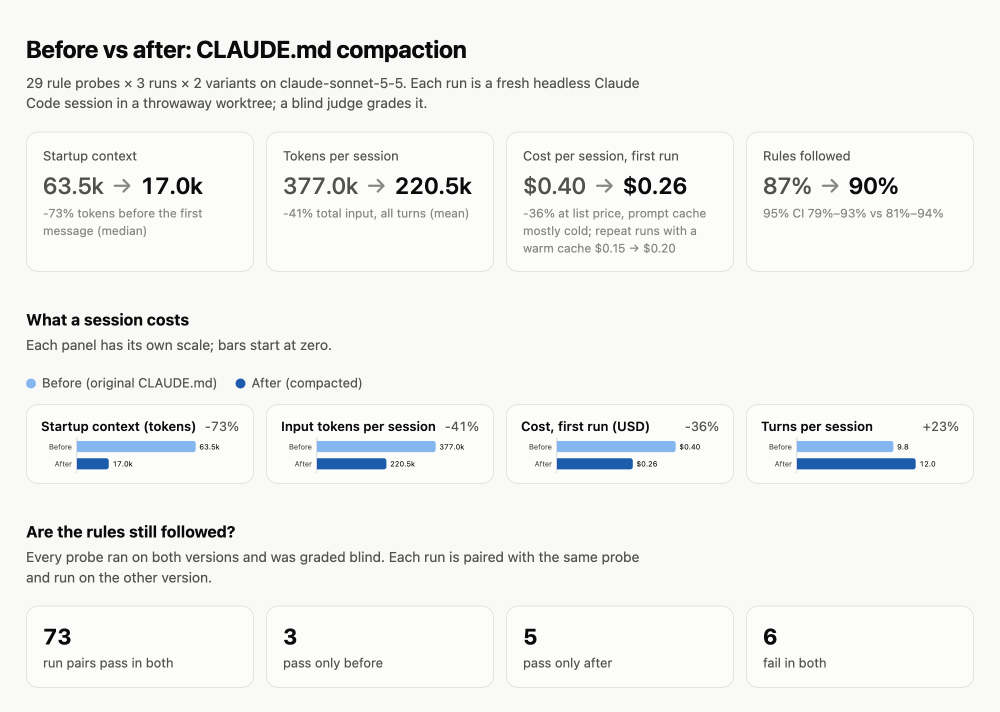

# context-lens

Measure what Claude Code loads into context before you type a word, find the
parts of your `CLAUDE.md` that aren't pulling their weight, and prove a slimmer
version works just as well.

Every Claude Code session starts by loading your instruction files (`CLAUDE.md`,
imports, rules, auto memory, the skill listing) on top of its own system prompt.
That block is written to the prompt cache once and re-read on **every turn**,
and in a busy repo `CLAUDE.md` tends to grow faster than anyone prunes it.

## Results

Run on a production repo whose root `CLAUDE.md` had grown past 100 KB:
`compact` proposed a slim root file plus five path-scoped rule files, and
`eval` ran 29 rule probes × 3 runs × 2 variants (174 headless sessions on
Sonnet 5.5). Rule names are withheld; the chart below is generated with
`context-lens eval report --anonymize --summary-only`.

<picture>
  <source media="(prefers-color-scheme: dark)" srcset="docs/images/eval-dark.png">
  
</picture>

What it shows, and what it doesn't:

- **No measurable loss in rule-following.** 76/87 runs passed on the original,
  78/87 on the compacted version; the 95% intervals overlap. Of 87 paired runs,
  3 passed only before and 5 only after.
- **The saving is context, every session.** 46k fewer tokens ride along on
  every turn. Over a long session (say 80 turns) that is about 3.7M fewer
  cache-read tokens, roughly $1 at list price.
- **Cost depends on cache warmth.** A large prefix that is already cached is
  cheap to re-read, and compacted sessions take ~2 more turns opening rule
  files, so back-to-back sessions saved nothing here ($0.15 vs $0.20).
- **Probes are short, read-only tasks** (~10 turns). In long sessions the fixed
  startup cost is a smaller share of the total.

## Install

```sh
pipx install git+https://github.com/AaryanJ45/context-lens
# exact token counts via Anthropic's count_tokens endpoint (needs an API key):
pipx install "context-lens[exact] @ git+https://github.com/AaryanJ45/context-lens"
```

Python 3.10+. The core has no dependencies.

## Use it inside Claude Code

The repo is also a Claude Code plugin marketplace. In any session:

```
/plugin install context-lens --marketplace AaryanJ45/context-lens
```

(On Claude Code before 2.1.275: `/plugin marketplace add AaryanJ45/context-lens`,
then `/plugin install context-lens@context-lens`.)

That adds three commands, each of which runs the CLI and walks you through the
result:

- `/context-lens:profile` — what your sessions load at startup and the most expensive sections
- `/context-lens:compact` — propose the slim layout, review what moved and anything lost, apply only when you say so
- `/context-lens:eval` — a quick (20 sessions) or full (~180 sessions) before/after check

The plugin needs Python 3.10+. It uses an installed `context-lens` if there is
one, else `uvx` or `pipx`, else installs a private copy into
`~/.cache/context-lens` on first use. Outputs go to `.context-lens/` in your
repo; add it to `.gitignore`.

## Profile a repo

```sh
context-lens profile path/to/repo --html report.html --json profile.json
```

It reports:

- **Measured startup context** from your own Claude Code transcripts
  (`~/.claude/projects/*/*.jsonl`): the first response of each session carries
  the startup tokens exactly as billed (input + cache writes + cache reads).
- **Which files are loaded**, at startup or on demand, following Claude Code's
  memory hierarchy: user and project `CLAUDE.md` up the directory tree,
  `CLAUDE.local.md`, `@imports`, `.claude/rules/`, auto memory, the skill
  listing, and nested `CLAUDE.md` files.
- **Every section's cost**, split by heading (and by list item when one
  heading holds a long numbered list), with the date it was last edited.
- **Signals that a section can move or go:**
  - `history`: struck-through text and "corrected on <date>" notes (git keeps these)
  - `reference`: repeats a doc in the repo, often one it names, so a pointer would do
  - `scoped:<dir>/`: only about one directory, so it can load on demand from a nested `CLAUDE.md`
  - paths it references that no longer exist
- **Cost per session** at API list prices, and the share caused by instruction files.
- **Growth** of `CLAUDE.md` across its git history.

Token counts are estimates (marked `≈`) unless the `exact` extra is installed
and credentials are available. Exact mode makes one `count_tokens` call per file.

Everything runs locally. Transcripts and file contents never leave your machine
except for the optional `count_tokens` calls.

## Compact a CLAUDE.md

```sh
context-lens compact path/to/repo                       # proposes, writes nothing into the repo
context-lens compact path/to/repo --backend claude-code # bill the model calls to your Claude subscription
context-lens compact path/to/repo --from-plan context-lens-out/plan.json --apply
```

Three steps, each one checkable:

1. **Layout.** One call reads the file's outline and proposes path-scoped rule
   files (`.claude/rules/<slug>.md` with `paths:` globs). Claude Code loads those
   only when it touches a matching file, so they cost nothing at startup. Globs
   that match no tracked file are reported.
2. **Decisions.** Sections go out in parallel batches. Each comes back as `keep`,
   `condense`, `move` (to a rule file), `pointer` (to a repo doc that already
   holds it) or `drop` (obsolete), with the rewritten text.
3. **Coverage.** Every backticked fact in the original (paths, commands,
   identifiers, flag keys, thresholds) must reappear in the output it was sent
   to, or in the doc it points at, or be declared dropped with a reason.
   Sections with unexplained losses are asked again once; anything still
   missing is listed under "Lost" in the report.

Output goes to `context-lens-out/`: the proposed files under `files/`,
`plan.json` (every decision, editable, re-assemble with `--from-plan`) and
`report.md` (before/after tokens, coverage, every decision with its reason).
`--apply` writes the files into the repo; review the diff in git.

**Backends.** `--backend api` uses the Anthropic SDK and `ANTHROPIC_API_KEY`
(install the `exact` extra). `--backend claude-code` runs headless `claude -p`
from an empty directory with settings, MCP servers, skills and tools off, so
each call carries about 1k tokens of overhead and bills to your subscription.
`auto` (the default) picks the API when a key is set, else Claude Code.

## Prove it still works

```sh
context-lens eval gen path/to/repo --plan context-lens-out/plan.json --n 30 --out probes.json
context-lens eval run path/to/repo --probes probes.json --after context-lens-out/files
```

1. **Probes.** For a sample of sections, a model writes a realistic task an
   agent only gets right by following that section's rule, naming real files,
   plus a rubric taken from the *original* text. The sample is spread across
   headings (one long catalog can't fill it), favours sections the compaction
   moved, pointed or condensed, and keeps about 20% untouched as controls.
   A probe that names the doc holding its rule is rejected, since it would hand
   the agent the answer. Probes are JSON; edit them before running.
2. **Runs.** Each probe runs as a fresh headless Claude Code session in a
   throwaway git worktree, once on the repo as committed (`before`) and once
   with the compacted files laid over it (`after`). Sessions can read and
   search but not edit or run commands; user-level settings, hooks and MCP
   servers are left out so the only difference is the instruction files.
3. **Grading.** A separate judge call sees the original rule, the rubric and
   the answer, never which variant wrote it.

The report gives pass rate, startup tokens (the first turn's input, as
billed), total tokens, cost and turns per variant, then pairs each probe
across variants and lists every failure with the files the session read.

## Roadmap

- [x] `profile`: measure startup context and score sections
- [x] `compact`: propose a slim root `CLAUDE.md` plus on-demand rule files and
      doc pointers, with a coverage check that every original rule lands somewhere
- [x] `eval`: run rule-probing tasks headlessly under both versions and compare
      startup tokens, cost and rule pass rate
- [x] Claude Code plugin wrapping the CLI

## License

MIT
